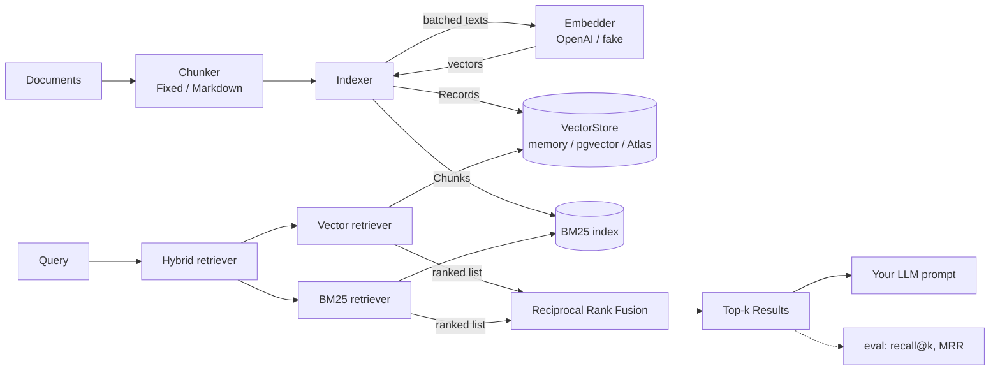

# go-rag-kit

[](https://github.com/neerajsinghi/go-rag-kit/actions/workflows/ci.yml)
[](https://pkg.go.dev/github.com/neerajsinghi/go-rag-kit)

A small RAG (retrieval-augmented generation) toolkit for Go, built with production use in mind: chunking, embeddings, vector stores, hybrid BM25 + vector retrieval with Reciprocal Rank Fusion, and an evaluation harness. The core module has **zero dependencies** beyond the standard library.

## Why

Most RAG tooling is written in Python. If your services are in Go, you end up either running a Python sidecar just for retrieval or hand-rolling the same pieces again and again. go-rag-kit gives you those pieces as small, composable, well-tested Go packages:

- **Interfaces you can swap.** `Chunker`, `Embedder`, `VectorStore` and `Retriever` are each a single small interface. You can bring your own implementation of any of them.
- **Hybrid retrieval included.** Dense vectors are good at paraphrases but weak on exact identifiers such as error codes, SKUs and function names. BM25 is the reverse. go-rag-kit includes both and fuses them with RRF.
- **You can measure it.** You can't improve retrieval without measuring it. `ragkit-eval` reports recall@k and MRR for a labelled query set, so you can compare chunkers, embedders and retrieval modes.
- **No dependencies in the core module.** The pgvector adapter uses `database/sql`, so you supply the driver. The MongoDB adapter is written against a tiny interface, so the driver stays in your module, not in this one.

## Features

| Area | Package | What you get |
|---|---|---|
| Core types | `ragkit` | `Document`, `Chunk`, `Record`, `Result`, the four interfaces, `Indexer` (chunk → batch-embed → upsert → keyword sinks) |
| Chunking | `chunk` | `Fixed` (rune-based windows with overlap) and `Markdown` (ATX-heading aware, keeps fenced code intact, records the heading path as `section` metadata). Every chunk keeps the source metadata and exact byte offsets. |
| Embeddings | `embed/openai` | OpenAI `/v1/embeddings` client on plain `net/http`. It batches inputs, retries 429/5xx with exponential backoff, honours `Retry-After`, respects the context, and works with any OpenAI-compatible base URL. |
| | `embed/fake` | Deterministic hashing-trick embedder for tests, CI and offline baselines |
| Vector stores | `store/memory` | Exact cosine similarity with a bounded heap. Safe for concurrent use, validates whole batches before writing, never aliases caller memory. |
| | `store/pgvector` | PostgreSQL + pgvector over `database/sql`. Includes idempotent migrations, an HNSW cosine index, transactional upserts and safe identifier handling. |
| | `store/mongovector` | MongoDB Atlas Vector Search through a 3-method `Collection` interface |
| Retrieval | `retrieve` | `Vector`, `BM25` (pure-Go inverted index, Okapi BM25 with tunable k1/b), `RRF` / `WeightedRRF`, and `Hybrid`, which queries several retrievers concurrently and fuses the results |
| Evaluation | `eval`, `cmd/ragkit-eval` | JSONL loaders, `RecallAtK`, `ReciprocalRank`, `Evaluate` (with document-level de-duplication) and a CLI that compares modes |

## Quickstart

```sh
go get github.com/neerajsinghi/go-rag-kit@latest

# Runs offline with the fake embedder; set OPENAI_API_KEY to use OpenAI.
go run github.com/neerajsinghi/go-rag-kit/examples/quickstart@latest
```

## Usage

```go
ctx := context.Background()

emb := openai.New(os.Getenv("OPENAI_API_KEY")) // or fake.New(256) in tests
store := memory.New()                         // or pgvector.New(db, "rag_chunks", 1536)
keywords := retrieve.NewBM25()

ix := &ragkit.Indexer{
	Chunker:  chunk.Markdown{MaxSize: 800, Overlap: 80},
	Embedder: emb,
	Store:    store,
	Sinks:    []ragkit.ChunkSink{keywords}, // the BM25 index is fed in the same pass
}
if _, err := ix.Index(ctx, docs...); err != nil {
	log.Fatal(err)
}

hybrid := retrieve.NewHybrid(retrieve.NewVector(emb, store), keywords)
results, err := hybrid.Retrieve(ctx, "what does PAY-4021 mean?", 5)
if err != nil {
	log.Fatal(err)
}
for _, r := range results {
	fmt.Println(r.Chunk.Metadata["path"], r.Chunk.Metadata[chunk.MetaSection], r.Score)
}
```

Use the retrieved `r.Chunk.Text` as context in your LLM prompt. go-rag-kit doesn't depend on any particular LLM client.

### Evaluate retrieval

```sh
go run ./cmd/ragkit-eval \
  -corpus examples/eval/corpus.jsonl \
  -queries examples/eval/queries.jsonl \
  -k 3
```

```text
corpus: 12 documents, 12 chunks; queries: 12; embedder: fake (256 dims)

MODE    RECALL@3  MRR@3
bm25    0.958     0.944
vector  0.917     0.917
hybrid  0.958     0.944
```

The query file has one JSON object per line: `{"query": "...", "relevant_ids": ["doc-id", ...]}`. Add `-v` for per-query results, `-json` for machine-readable output, or `-embedder openai` to evaluate real embeddings. `-chunker`, `-chunk-size` and `-overlap` let you compare chunking strategies. These sample numbers use the offline hashing embedder, so they show the harness working, not how good semantic retrieval can get.

### pgvector

```go
import _ "github.com/jackc/pgx/v5/stdlib" // any database/sql Postgres driver

db, _ := sql.Open("pgx", os.Getenv("DATABASE_URL"))
store, err := pgvector.New(db, "rag_chunks", 1536)
if err != nil { ... }
if err := store.Migrate(ctx); err != nil { ... } // extension, table, HNSW index (IF NOT EXISTS)
```

`store.MigrateSQL()` returns the DDL if you'd rather run it from your own migration tool.

### MongoDB Atlas Vector Search

`mongovector` depends on a three-method interface, so the MongoDB driver lives only in your module. Here is a wrapper for `go.mongodb.org/mongo-driver/v2`:

```go
type mongoColl struct{ c *mongo.Collection }

func (m mongoColl) Aggregate(ctx context.Context, p []map[string]any) ([]map[string]any, error) {
	cur, err := m.c.Aggregate(ctx, p)
	if err != nil {
		return nil, err
	}
	var out []map[string]any
	return out, cur.All(ctx, &out)
}

func (m mongoColl) ReplaceByID(ctx context.Context, id string, doc map[string]any) error {
	_, err := m.c.ReplaceOne(ctx, bson.M{"_id": id}, doc, options.Replace().SetUpsert(true))
	return err
}

func (m mongoColl) DeleteByIDs(ctx context.Context, ids []string) error {
	_, err := m.c.DeleteMany(ctx, bson.M{"_id": bson.M{"$in": ids}})
	return err
}

store, err := mongovector.New(mongoColl{client.Database("rag").Collection("chunks")}, "vector_index")
```

## Architecture



The dependency direction is strict: sub-packages import the root `ragkit` package for types and interfaces, and the root package imports nothing from them.

```text
ragkit (types, interfaces, Indexer)
├── chunk/              Fixed, Markdown
├── embed/openai/       net/http client
├── embed/fake/         deterministic hashing embedder
├── store/memory/       exact cosine, in-process
├── store/pgvector/     database/sql + pgvector
├── store/mongovector/  Atlas $vectorSearch via a small interface
├── retrieve/           Vector, BM25, RRF, Hybrid
├── eval/               metrics, JSONL loaders, Evaluate
├── cmd/ragkit-eval/    evaluation CLI
└── examples/           quickstart + sample eval set
```

## Design notes

- Chunk sizes are counted in runes, so multi-byte text is never cut mid-character. `Chunk.Start` and `Chunk.End` are byte offsets, and `doc.Text[c.Start:c.End] == c.Text` always holds, which makes highlighting and citations exact.
- RRF uses only ranks (`Σ 1/(k + rank)`, with k = 60 by default), so cosine similarity and BM25 scores never need to be put on the same scale.
- All outputs are deterministic, with ties broken by chunk ID, so evaluation results are reproducible.
- Errors wrap `ragkit.ErrInvalidArgument` or `ragkit.ErrDimensionMismatch`, so callers can check them with `errors.Is`. Bad input returns an error and never panics.
- None of the tests touch the network: OpenAI is tested against `httptest`, pgvector against a fake `database/sql` driver, and Atlas against a fake collection.

## Roadmap

- [ ] Integration tests for pgvector and Atlas using testcontainers, kept in a separate module so the core stays dependency-free
- [ ] Metadata filters in `VectorStore.Search` (pgvector `WHERE`, Atlas `filter`)
- [ ] More embedders: Ollama, Voyage, Cohere, Vertex AI
- [ ] Rerankers (a cross-encoder or LLM-as-reranker) as a `Retriever` decorator
- [ ] Setext headings and token-based (tiktoken-compatible) chunk sizing
- [ ] Persisting and snapshotting the BM25 index
- [ ] More metrics in the eval harness: nDCG and precision@k

## License

[MIT](LICENSE) © 2026 Neeraj Singhi
